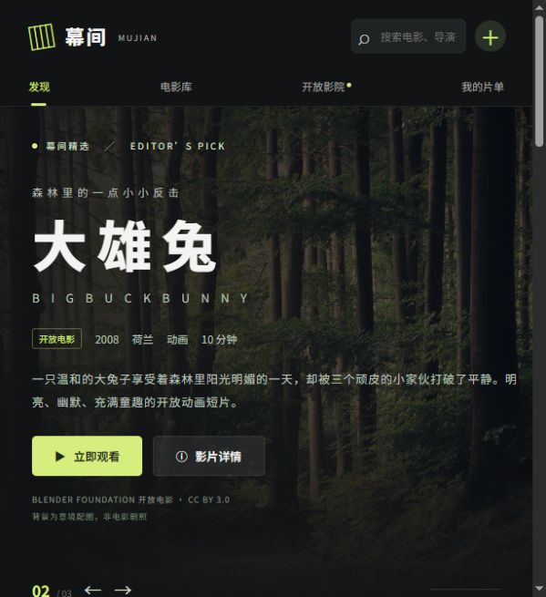

# 幕间 MUJIAN

中文电影探索网站，原生 HTML、CSS、JavaScript，无构建依赖。

## 本地运行

需要 Python 3。在 Windows 上双击 `start.cmd`，或在项目目录执行 `python -m http.server 4173 --directory dist`，访问 http://localhost:4173。

网站静态入口为 `dist/index.html`。部署时将 `dist/` 设为站点根目录，无需安装依赖或构建。

## 已实现

- 响应式首页、3 部精选切换、12 部内置影片资料。
- 片名 / 英文片名 / 导演搜索，类型、年代筛选及排序。
- 4 部 Blender 开放电影 HTML5 播放、全屏、播放进度续播。
- 收藏、观看记录和 JSON 片库导入，保存在 localStorage。
- 影片来源、创作者署名、Creative Commons 许可链接。
- 无播放资源的影片仅展示资料及 TMDB 搜索链接。

## 数据与限制

本版本没有全量电影数据库、云端用户系统或视频托管后台。《大雄兔》完整视频（9 分 56 秒）已经压缩为约 10MB 的 480×270 MP4 并随项目保存，来源为 W3C 的公开镜像 https://media.w3.org/2010/05/bunny/movie.mp4 。本站版本降低画质，保留完整音视频内容和片尾署名。其他 3 部开放电影仍来自外部 HTTPS MP4；本次网络测试中 Google 示例桶返回 403，无法保证可用。经典电影配图为 Unsplash 意境照片，并非官方海报。影片元数据为静态精选条目。

可以点击网站右上角「＋」或页脚「导入片库」，下载模板后批量导入。导入数据仅保存在当前浏览器，不会上传；JSON 每次 1–500 条，最大 3MB，最多累计 2000 条导入影片。ID 与内置条目冲突时跳过，与已导入条目相同则更新。支持字段见页面模板。请只导入拥有或获授权的视频。

后续完整产品可扩展：服务端电影资料 API 适配、分页数据库、用户认证、对象存储、视频转码、HLS 与字幕轨。API 密钥应保存在服务端环境变量，不能放入静态前端。

## 开放电影来源

- Sintel：https://durian.blender.org/
- Big Buck Bunny：https://peach.blender.org/about/
- Tears of Steel：https://mango.blender.org/about/
- Elephants Dream：https://orange.blender.org/

每部影片详情展示对应署名和许可。《大雄兔》视频已重新压缩，其他外链视频未作修改。《大雄兔》的剧照从本地视频提取；其他 MP4 和剧照使用 Google 公共示例桶。意境照片来自 Unsplash，字体来自 Google Fonts。UI 在资源失败时仍保留文字及渐变背景。详见 [第三方素材说明](THIRD_PARTY_NOTICES.md)。
